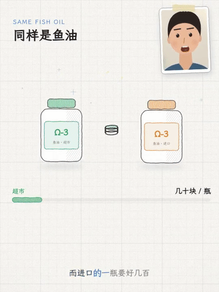
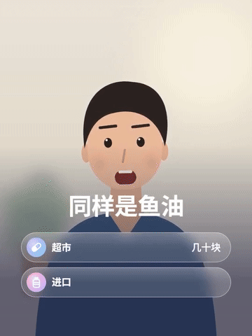
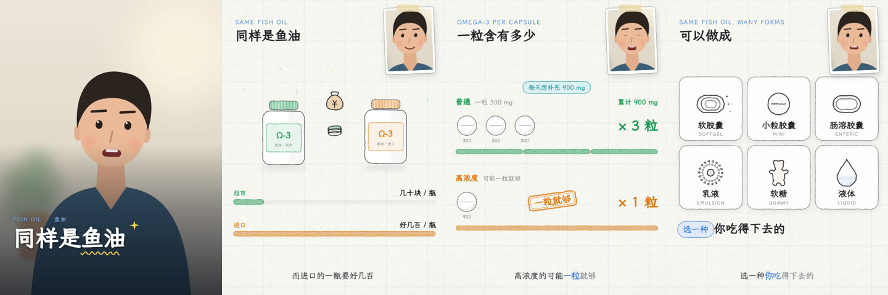
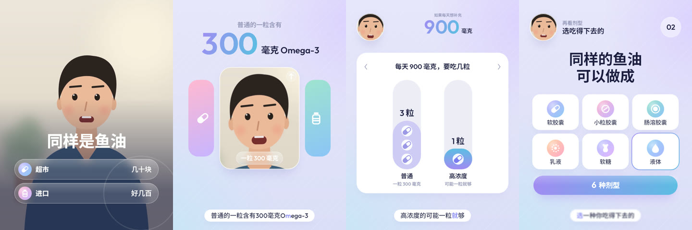

# aicut

A [Claude Code](https://claude.com/claude-code) skill that turns a talking-head (口播) clip into an animated explainer
video. You give Claude a clip; it transcribes the speech, storyboards motion graphics on the spoken words, shows you
a low-res preview, and hands you a render kit that renders the full-quality video on any machine.

Output resolution and aspect ratio follow the source clip (3:4, 9:16, 4:5, 1:1, 16:9). Every on-screen word comes
from what the speaker actually says. The engine is plain Python + [skia](https://kyamagu.github.io/skia-python/) +
ffmpeg, with each frame a pure function of time, so renders are deterministic and can be split across machines.

## What it looks like

The same 35-second script in each template. The presenter here is a drawn stand-in from [`demo/`](demo/); in your
videos it is your own live footage.

| Template 1: Whiteboard | Template 2: Pop Card | Template 3: Soft Glass |
|:-:|:-:|:-:|
|  |  |  |
| [Full clip with sound](docs/whiteboard-demo.mp4) | [Full clip with sound](docs/popcard-demo.mp4) | [Full clip with sound](docs/softglass-demo.mp4) |

**Template 1: Whiteboard**: a title over the presenter, a price comparison, capsule rows with a counter and stamp, form cards.


**Template 2: Pop Card**: bottles whipping in, big numbers on a colour sheet, bouncing capsules, a slammed form grid.


**Template 3: Soft Glass**: glass rows over the video, a gradient odometer beside the hero card, a bar chart, form tiles.


The demo script is made up for illustration (300 mg × 3 = 900 mg is arithmetic, not health advice).

## Three looks

| | Template 1: Whiteboard | Template 2: Pop Card | Template 3: Soft Glass |
|---|---|---|---|
| Look | Grid paper, pencil strokes, handwritten type | White cards, vibrant colour, inked cartoon objects | Flat lavender with faint diagonal lines, frosted glass, lilac-to-sky gradients |
| Motion | Draw-on, stamps, eraser wipes | Bouncy motion graphics: pop, whip, drop, slam | Rise into focus, odometer numbers, frost cuts |
| Presenter | Full frame, taped corner photo, or hidden | Live video in any position | Live video as a hero card, round avatar or any slot |
| Sound | Music bed + foley | Sound effects, no music | Sound effects, no music |

## Install

You need Claude Code, **Python 3.10 to 3.13** and **ffmpeg** (with ffprobe) on PATH.

**macOS / Linux**
```bash
git clone https://github.com/LexWayne2026/aicut.git ~/.claude/skills/aicut
~/.claude/skills/aicut/install.sh
```
ffmpeg: `brew install ffmpeg` (macOS) or `sudo apt install ffmpeg` (Debian/Ubuntu).

**Windows**
1. Install Python 3.12 from [python.org](https://www.python.org/downloads/) and tick **Add python.exe to PATH**.
2. Install ffmpeg: `winget install Gyan.FFmpeg`, then open a new terminal.
3. Download this repo (**Code > Download ZIP**, or `git clone`), then double-click `install-windows.bat`.

Details and troubleshooting: [INSTALL-WINDOWS.md](INSTALL-WINDOWS.md).

Both installers copy the skill to `~/.claude/skills/aicut`, create a Python environment at `~/.wbx-venv`
(skia-python, numpy, OpenCV, faster-whisper), and finish with a self-test that draws a frame in each template.
Wait for `OK: aicut is ready`, then restart Claude Code. The Whisper speech model (about 3 GB for `large-v3`)
downloads the first time you transcribe.

## Use

In Claude Code, name the template and point at your clip:

> aicut Template 3, make an explainer from `~/Videos/vitamins.mp4`

If you don't name a template, Claude asks which one. Then it works through these steps with you:

1. **Transcribe.** It sets up a project next to your clip and transcribes it with Whisper.
2. **Check the transcript.** You fix misheard words. Text on screen is taken from this transcript, so it matters.
3. **Storyboard.** Claude writes the scenes, timing every animation to a spoken word.
4. **Preview.** You get a half-resolution, 30 fps preview with sound. Give feedback in plain words ("too many
   cards", "move the presenter left") and it revises.
5. **Render kit.** When you're happy, you get `<name>-render-kit.zip`, which holds the engine, fonts, your project and
   the clip.

Unzip the kit on a fast machine with Python and ffmpeg and run:

```bash
./render.sh <name>            # macOS / Linux
render.bat <name>             # Windows
```

It renders on every CPU core at source resolution and 60 fps, to `projects/<name>/out/<name>-master.mp4`. Add
`--mb 6` for motion blur. See `templates/kit/RENDER.md` for more options.

### Without Claude

The tools also run directly. `PY` is `~/.wbx-venv/bin/python`, or `~/.wbx-venv/Scripts/python.exe` on Windows.

```bash
PY tools/new_project.py clip.mp4 projects/demo --template 2 --lang zh   # probe + transcribe + starter scenes
PY wbx/render.py --project projects/demo --stills 2,8,15                # PNG stills
PY wbx/render.py --project projects/demo --preview                      # low-res preview video
PY tools/package.py projects/demo                                       # render kit zip
```

Scenes are Python functions in `projects/<name>/scenes.py`. Timing cues live in `timeline.py` and are looked up
from the transcript with `at("phrase", "word")`.

To try the engine with no clip at all, render the demo:

```bash
PY demo/make_demo.py                                       # stand-in presenter clip + transcript
PY wbx/render.py --project demo/softglass --preview        # or demo/popcard, demo/whiteboard
```

## What's in the repo

| Path | Contents |
|---|---|
| `SKILL.md` | The skill instructions Claude follows |
| `wbx/` | Engine: Template 1 (`core`, `icons`, `components`), Template 2 (`popcard`), Template 3 (`softglass`), layout, audio, parallel render |
| `tools/` | New project, probe (face-aware crop, silences), transcription, caption sync check/fix, delivery QC, contact sheets, packaging, self-test |
| `references/` | Style rules and the API for each template, plus storyboarding and animation principles |
| `templates/` | Starter projects per template and the render-kit launchers |
| `demo/` | Three complete demo projects on a made-up script, with a drawn stand-in presenter. `make_gallery.py` rebuilds `docs/` |
| `docs/` | The README gallery: GIFs, stills and full demo clips |
| `fonts/`, `music/` | Bundled fonts and Template 1 music, all freely licensed (below) |

## Licences

aicut's code and docs are under the [MIT licence](LICENSE). Bundled assets keep their own licences:

- **Fonts** (SIL Open Font License 1.1):
  - [LXGW WenKai](https://github.com/lxgw/LxgwWenKai)
  - [Resource Han Rounded](https://github.com/CyanoHao/Resource-Han-Rounded)
  - [Outfit](https://github.com/Outfitio/Outfit-Fonts)
  - [Noto Sans SC](https://github.com/notofonts/noto-cjk)

  Each licence file is in `fonts/`.
- **Music:** Holizna, *Happy Lo-Fi*, from [OpenGameArt](https://opengameart.org/content/happy-lo-fi-lofi-collection), CC0 public domain.
- **Animation principles:** adapted in concept from [remotion-dev/skills](https://github.com/remotion-dev/skills). No Remotion code is used.
- **Caption sync check, QC list, render watchdog and comfort rules:** `tools/check_sync.py` adapts the waveform
  onset check, and `tools/qc.py`, the `wbx/parallel.py` watchdog and the measured rules in
  `references/storyboarding.md` follow the methods of
  [paxon-yang/talking-video-skills](https://github.com/paxon-yang/talking-video-skills), MIT licence,
  "Copyright (c) 2026". Its notice: *Permission is hereby granted, free of charge,
  to any person obtaining a copy of this software and associated documentation files (the "Software"), to deal in
  the Software without restriction, including without limitation the rights to use, copy, modify, merge, publish,
  distribute, sublicense, and/or sell copies of the Software, and to permit persons to whom the Software is
  furnished to do so, subject to the following conditions: The above copyright notice and this permission notice
  shall be included in all copies or substantial portions of the Software. THE SOFTWARE IS PROVIDED "AS IS",
  WITHOUT WARRANTY OF ANY KIND.*
